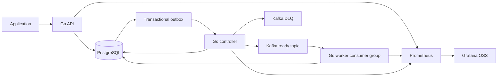

# FluxRail

**From events to execution.**

A planned distributed job orchestration engine built with **Go, Apache Kafka, PostgreSQL, Docker, Kubernetes, and Prometheus/Grafana**.

Applications should be able to submit background work without owning the machinery for dispatch, retries, scheduling, and crash recovery. FluxRail is designed to persist that work, distribute execution across workers, and expose the evidence needed to understand what happened.

> **Project status: Phase 0 — architecture and documentation.** No application, deployment, CI pipeline, or benchmark has been implemented. All runtime behavior below is a design contract to be validated during implementation. This is a learning-oriented infrastructure project, not feature parity with Temporal, Celery, or Argo Workflows.

## Documentation

| Document | Contents |
|---|---|
| [High-level design](docs/HLD.md) | Requirements, component boundaries, seven architecture and sequence diagrams, guarantees, scaling, and security |
| [Low-level design](docs/LLD.md) | State machine, PostgreSQL schema, REST contracts, Kafka envelopes, execution algorithms, configuration, and metrics |
| [Implementation roadmap](docs/ROADMAP.md) | Ordered phases, artifacts, dependencies, acceptance criteria, and future validation commands |
| [Kafka decision](docs/adr/0001-kafka-selection.md) | Broker and Go client selection |
| [Persistence and outbox decision](docs/adr/0002-persistence-and-outbox.md) | Durable state and the database-to-broker boundary |
| [Delivery semantics decision](docs/adr/0003-delivery-semantics.md) | At-least-once delivery, leases, fencing, and side effects |
| [Deployment decision](docs/adr/0004-local-and-kubernetes-deployment.md) | Compose first, kind and Helm later, ARM64 constraints |

## What FluxRail will do

- Accept immediate or delayed jobs through a versioned REST API.
- Store job state, execution attempts, results, and retry schedules in PostgreSQL.
- Publish execution requests through a transactional outbox to Kafka.
- Execute a fixed registry of safe Go handlers across a consumer group.
- Recover abandoned executions using leases and fenced database updates.
- Support bounded retries, dead-letter notifications, and cancellation.
- Expose throughput, duration, backlog, failures, and worker health.
- Demonstrate horizontal scaling locally with kind, Helm, and optional KEDA.

Use cases include report generation, JSON transformations, bounded background computation, and independent batch jobs. The initial handlers simulate or compute local workloads; they do not run arbitrary commands or fetch arbitrary URLs.

## System architecture



The outbox is a PostgreSQL table, not a separate storage system. The controller hosts the dispatcher, scheduler, and recovery loops; these are logical responsibilities rather than independent microservices. Kubernetes later manages processes and replica counts, while PostgreSQL continues to own execution state.

### Execution flow

1. The API validates the handler payload and idempotency key.
2. One transaction inserts the job and, for immediate jobs, its ready outbox event.
3. The dispatcher publishes the event and marks it published only after Kafka acknowledges it.
4. A worker claims the current dispatch generation in a short database transaction, creating an attempt and execution lease.
5. The handler runs outside the transaction. The worker renews its lease and persists its outcome using its fencing token.
6. The worker commits the Kafka offset after durable disposition. Failures either schedule a database-backed retry or write a terminal outcome and DLQ outbox event.

Delayed jobs and retries use `next_run_at` in PostgreSQL. Consumers do not sleep while waiting for a scheduled execution time.

## Technology and purpose

| Area | Choice | Purpose |
|---|---|---|
| Language and HTTP | Go, Gin | REST routing, middleware, request validation and JSON responses; explicit server timeouts and shutdown |
| Kafka client | franz-go | Explicit producer acknowledgements, consumer offsets, and rebalance control; [comparison](docs/adr/0001-kafka-selection.md) with IBM Sarama |
| Messaging | Apache Kafka, KRaft | Durable partitioned transport and consumer-group distribution |
| Persistence | PostgreSQL, pgx | Atomic state changes, leases, schedules, and outbox transactions |
| Migrations | golang-migrate/migrate | Ordered, reviewable SQL schema changes |
| Development | Docker Compose | Reproducible broker and database without cloud services |
| Packaging | Docker, multi-platform builds | Linux ARM64 and AMD64 application images |
| Kubernetes | kind, Helm | Local cluster and repeatable deployment packaging |
| Autoscaling | KEDA Kafka scaler | Demonstrate lag-based worker replica changes |
| Metrics and dashboards | Prometheus, Grafana OSS | Operational signals and visual investigation |
| Logging | Go `slog`, JSON | Structured correlation by job, attempt, and event |
| Tests | Go testing, Testcontainers where useful | State-machine, race, integration, and failure tests |
| Load and CI | k6, GitHub Actions | Reproducible submission load and automated validation in later phases |
| Optional tracing | OpenTelemetry | Later HTTP-to-Kafka-to-attempt trace propagation |

Exact dependency versions and image digests will be pinned and compatibility-tested in Phase 1; this documentation does not claim a tested version matrix. [HLD sources](docs/HLD.md#technical-references) explain the underlying platform behavior.

## Feature status

| Status | Scope |
|---|---|
| Implemented | Phase 0 Markdown design artifacts only |
| In progress | No runtime implementation |
| Planned: core MVP, Phases 1–4 | Submission, status/history/results, outbox, distributed workers, leases, retry, delayed jobs, DLQ, cancellation |
| Planned: operational showcase, Phases 5–7 | Metrics, dashboards, containers, Kubernetes, KEDA, CI, integration/failure tests, measured benchmarks |
| Future | Recurring schedules, priority, multi-tenancy, gRPC, tracing, web UI, dependency-aware workflows |

## Reliability contract

The intended model is **at-least-once delivery with duplicate suppression and fenced state updates**. PostgreSQL is authoritative; consuming a Kafka record does not mean a job succeeded. A transactional outbox avoids the unsafe database-write/broker-write gap, but an acknowledgement lost before publication is recorded can still cause a duplicate.

A lease permits recovery after a worker disappears. A monotonically increasing token prevents an expired worker from changing FluxRail's database state. It cannot undo an external side effect. External integrations must accept stable idempotency keys or enforce fencing themselves. **End-to-end exactly-once execution is not promised.**

The development broker uses three ready partitions, replication factor one, and a single KRaft node. This topology has no broker high availability. Durability depends on persistent volumes, database availability, retention policy, and eventual repair of outages. See [failure analysis](docs/LLD.md#failure-analysis) before evaluating guarantees.

## Proposed API

This example documents a future interface; there is no running server yet.

```http
POST /api/v1/jobs HTTP/1.1
Content-Type: application/json
Idempotency-Key: report-demo-001

{
  "type": "simulate_report",
  "payload": {"rows": 1000},
  "max_attempts": 3,
  "timeout_seconds": 30
}
```

```http
HTTP/1.1 202 Accepted
Location: /api/v1/jobs/0b7f5911-b420-4da9-8361-5461a8dd658c
Content-Type: application/json

{
  "id": "0b7f5911-b420-4da9-8361-5461a8dd658c",
  "status": "QUEUED",
  "attempts_started": 0,
  "max_attempts": 3,
  "dispatch_generation": 1
}
```

`QUEUED` means dispatch intent is durable, not that Kafka has acknowledged it. Repeating the same key and normalized request returns the same job; changing the request returns `409`. [LLD API contracts](docs/LLD.md#rest-api) specify list pagination, status/history, cancellation, manual retry, errors, and health endpoints.

## Roadmap

| Phase | Outcome |
|---|---|
| 0 | Architecture, contracts, roadmap, and ADRs — this repository state |
| 1 | Go foundation, configuration/logging, SQL migrations, Compose Kafka/PostgreSQL, smoke checks |
| 2 | Submission/status APIs, validation, idempotency, and reliable outbox publication |
| 3 | Multiple workers, claims, attempts, safe handlers, results, graceful shutdown |
| 4 | Scheduling, retries, DLQ, recovery, fencing, cancellation, failure injection |
| 5 | Prometheus metrics, Grafana dashboards, useful alerts |
| 6 | Images, kind, Helm, manual scaling, KEDA |
| 7 | Broader integration tests, CI, load experiments, measured benchmark report |

The [full roadmap](docs/ROADMAP.md) defines completion gates. Phase 3 is an execution milestone, not a crash-safe MVP; the core MVP closes only after Phase 4 failure tests pass.

## Local development approach

No paid cloud infrastructure is required. The primary design target is an Apple Silicon M1 machine, with AMD64 also supported. Windows development should use Docker Desktop with Linux containers and, for a Unix-like toolchain, WSL2.

**Mode A:** Go installed on the host; Kafka and PostgreSQL in Docker Compose; Prometheus/Grafana in an optional profile. Planned prerequisites are Git, a supported Go toolchain, Docker Engine/Desktop with Compose v2, and curl. Begin with a Docker VM budget around 4 CPUs and 6 GiB RAM, then measure actual use; this is a starting allocation, not a verified minimum.

**Mode B:** kind, kubectl, and Helm in addition to Mode A. The canonical demo runs single-instance Kafka/PostgreSQL inside kind, along with Go deployments. KEDA and monitoring are optional. This avoids ambiguous host-to-container Kafka advertised addresses. A hybrid Compose/kind topology is documented as an optional development variant in the [HLD](docs/HLD.md#local-deployment).

There are no setup commands that start FluxRail yet. Future commands in the roadmap are acceptance targets and depend on files introduced in their respective phases.

## Testing and performance

Tests will cover idempotency races, transaction rollback, duplicate delivery, partition revocation, stale-worker completion, cancellation races, broker/database outages, and interrupted outbox publication. Tests belong in the phase that introduces the behavior; Phase 7 expands the suite rather than postponing correctness testing.

Benchmarks will report submission and completion throughput separately, p50/p95 end-to-end latency, handler duration, success/failure rates, lag, resources, and duplicate handling. Runs must record hardware, workload mix, image/dependency versions, worker counts, concurrency, partitions, and warm-up. No performance measurements exist yet.

## Repository layout

```text
README.md
docs/
  HLD.md
  LLD.md
  ROADMAP.md
  adr/
    0001-kafka-selection.md
    0002-persistence-and-outbox.md
    0003-delivery-semantics.md
    0004-local-and-kubernetes-deployment.md
```

The future Go module layout is specified in the LLD. Empty source directories and infrastructure stubs are intentionally absent in Phase 0.

## Tradeoffs and open risks

- Kafka makes partitioning, consumer groups, retention, and lag visible, at the cost of more queue coordination than a task-oriented broker.
- PostgreSQL-backed leases and outbox simplify correctness but add database write load and require vacuum/retention planning.
- The initial worker executes sequentially per partition, bounding active jobs by assigned partitions as well as the worker concurrency limit. This makes offset commits easy to reason about; it can leave CPU unused.
- A single broker/database demonstrates recovery from process failures, not resilience to permanent disk loss or host failure.
- Scale-down and rebalance behavior, ARM64 image compatibility, and laptop memory budgets remain implementation validation gates.

Implementation begins with **Phase 1 — local development foundation**, only when explicitly requested.
