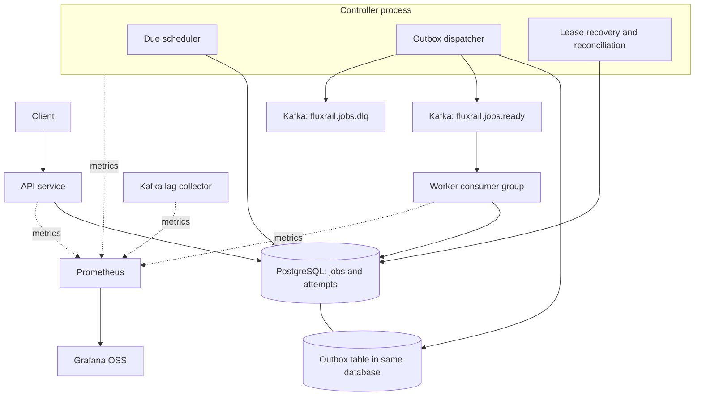
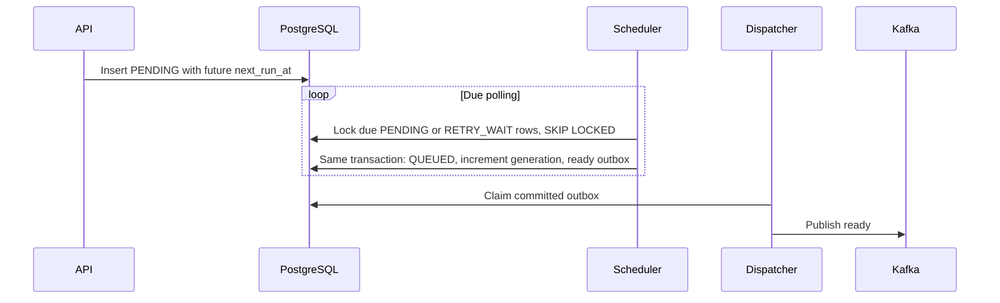
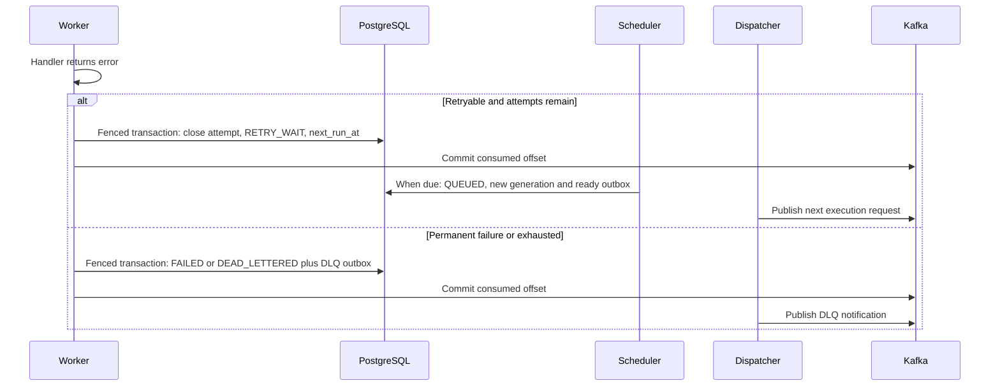
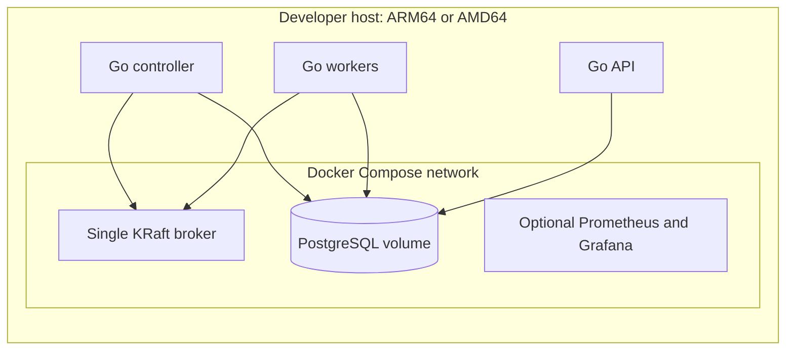
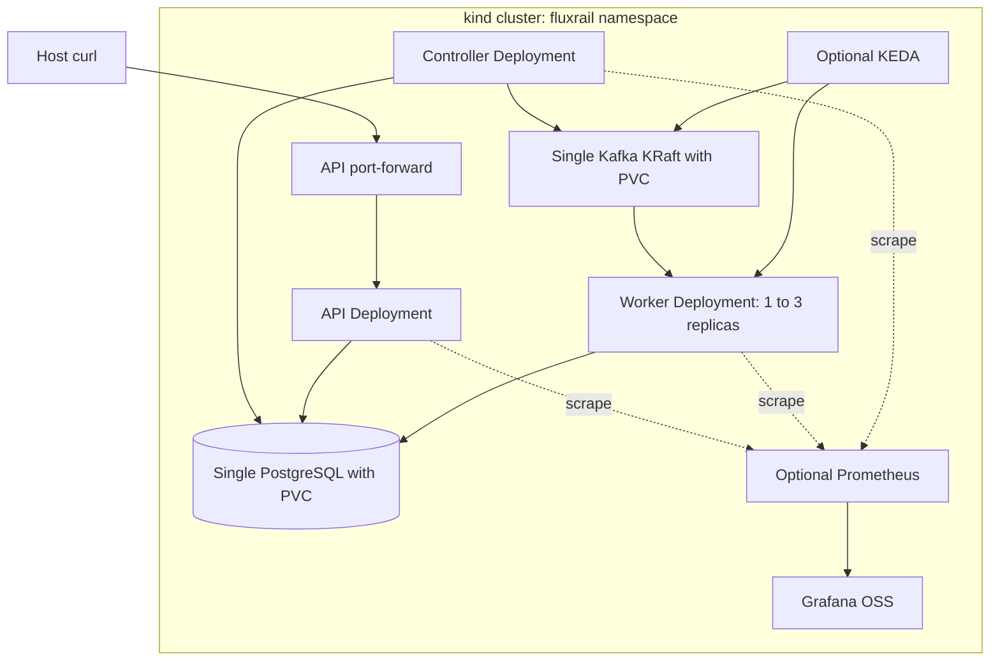

# FluxRail: high-level design

Status: proposed Phase 0 design, 2026-10-25. No runtime claims have been verified. [README](../README.md) · [LLD](LLD.md) · [Roadmap](ROADMAP.md)

## Problem and scope

FluxRail targets application developers who need independent background jobs with observable lifecycle and recovery. Example workloads are batches of reports, JSON transformations, and bounded computations. A submission of 10,000 jobs is a useful future test workload, not a demonstrated capacity.

The core MVP ends at Phase 4: REST submission/status/history/results, idempotency, immediate/delayed execution, durable outbox, multiple workers, attempts, retries, leases, recovery, cancellation, and dead-letter notification. Phases 5–7 add operational evidence and deployment demonstrations. DAGs, recurring schedules, priority, multi-tenancy, arbitrary code execution, hard real-time scheduling, and production multi-region availability are non-goals.

Assume one trusted local user, one PostgreSQL database, a single local Kafka KRaft broker, bounded JSON payloads/results, synchronized infrastructure clocks, and handlers that honor Go contexts. PostgreSQL time is authoritative for leases and scheduling. Recovery requires the database, broker, and controller to become available again; no fixed recovery-time SLO is claimed.

Functional requirements are defined by the [LLD](LLD.md). Operational requirements are reproducible local setup, bounded concurrency/memory, explicit timeouts, durable state transitions, structured logs, no mandatory cloud services, and ARM64 feasibility. Throughput and latency targets remain unset until measurements exist.

## Components and ownership

| Logical component | Responsibility | Initial process |
|---|---|---|
| API | Validate, enforce submission idempotency, persist jobs, serve queries/cancel/retry | `cmd/api` |
| PostgreSQL | Authoritative jobs, attempts, scheduling, leases, outbox | Database |
| Transactional outbox | Durable publication intent committed with job transitions | Table in PostgreSQL |
| Dispatcher | Lease unpublished outbox rows, publish, record acknowledgement | `cmd/controller` |
| Scheduler | Promote due `PENDING`/`RETRY_WAIT` jobs and insert ready events | `cmd/controller` |
| Recovery/reconciliation | Expire leases, fence abandoned attempts, repair queued delivery | `cmd/controller` |
| Kafka | Partitioned transport of ready and dead-letter notifications | Broker |
| Workers | Claim jobs, execute registered handlers, renew leases, persist outcomes | `cmd/worker` |
| Monitoring | Scrape metrics, expose dashboards, evaluate alerts | Optional Prometheus/Grafana |
| Kubernetes | Run processes, enforce resources, restart and scale deployments | Later kind/Helm |

Three Go processes permit independent scaling without turning every loop into a service. Multiple controller replicas are safe only through database row locking and expiring outbox claims; no leader election is required. Business rules reside in shared internal packages, not HTTP handlers or Kafka callbacks.

## Overall architecture



The dispatcher alone produces application events. Workers insert DLQ intents transactionally rather than dual-writing database state and Kafka messages.

## Submission and execution

```mermaid
sequenceDiagram
    participant C as Client
    participant A as API
    participant D as PostgreSQL
    participant O as Dispatcher
    participant K as Kafka
    participant W as Worker
    C->>A: POST job with idempotency key
    A->>D: Transaction: job QUEUED and ready outbox
    D-->>A: Commit
    A-->>C: 202 and job ID
    O->>D: Claim outbox with expiring token
    O->>K: Publish ready event
    K-->>O: Acknowledgement
    O->>D: Mark published if claim token still matches
    K->>W: Ready record
    W->>D: Claim generation, create attempt and lease
    W->>W: Execute bounded handler; renew lease
    W->>D: Fenced success transaction
    W->>K: Commit next offset
```

`QUEUED` is durable eligibility with an outbox intent. It does not imply broker delivery. Read APIs return committed database state and may show terminal state before the consumer offset is committed.

## Scheduled execution



Scheduling is best effort after `next_run_at`, with delay from polling, outages, outbox age, and backlog. Ordinary Kafka topics do not provide per-message delayed execution. No sleeping consumer or dedicated retry topic is required.

## Failure and retry



`FAILED` means a permanent/non-retryable error. `DEAD_LETTERED` means a retryable error exhausted its attempt budget. Both are terminal and produce a DLQ intent. The terminal status records intent even if DLQ delivery is temporarily unavailable. The DLQ is for inspection; replay uses the API to create a new job.

## Worker crash and recovery

```mermaid
sequenceDiagram
    participant Old as Old worker
    participant D as PostgreSQL
    participant R as Recovery loop
    participant S as Scheduler
    participant New as New worker
    Old->>D: Claim with fence 8, renew lease
    Old->>Old: Crash or lose database connectivity
    R->>D: Lock expired RUNNING row
    R->>D: Fence 9, close abandoned attempt; retry or terminal plus DLQ
    S->>D: Due retry to QUEUED with new generation and outbox
    New->>D: Claim with fence 10 and new attempt
    Old->>D: Late completion with fence 8
    D-->>Old: Reject update
```

A stale process may still perform an external effect. Fencing only protects the database unless the target also enforces tokens. Stable job IDs are external idempotency keys for automatic retries; manually cloned jobs require an explicit business-level deduplication policy.

## Delivery and consistency

**Database boundary.** Use PostgreSQL `READ COMMITTED` with short row locks, conditional updates, unique constraints, and transactionally coupled job/outbox writes. A job claim, attempt creation, and lease assignment commit together. No database transaction spans handler execution or broker I/O. PostgreSQL documents `SKIP LOCKED` as useful for queue-like consumers, while warning that it is not a general consistent-read mechanism. [PostgreSQL SELECT](https://www.postgresql.org/docs/current/sql-select.html)

**Broker boundary.** Use Kafka producer idempotence and all in-sync replica acknowledgements. The local single-replica topology has no redundant copy. Producer idempotence does not deduplicate a later application-level outbox resend. Kafka transactions do not atomically include PostgreSQL updates or external effects. [Kafka design](https://kafka.apache.org/41/design/design/)

**Consumption.** Disable automatic commits. One active handler per partition and a per-process semaphore provide bounded work without committing past unfinished records. Each partition advances only after durable disposition of its current record. Rebalances cancel revoked work, drain within a deadline, and commit only owned offsets; otherwise redelivery is expected. The exact franz-go callback wiring must be integration-tested. [franz-go consumption guide](https://github.com/twmb/franz-go/blob/master/docs/producing-and-consuming.md)

**Duplicates.** Outbox resend, lost offset acknowledgement, restart, rebalance, and recovery can all repeat delivery. Claims require the correct dispatch generation and `QUEUED` state. Terminal, obsolete-generation, and already-owned records cannot create a second current attempt. A live duplicate can be acknowledged because the persisted lease and recovery loop own its eventual resolution.

**Ordering.** Job ID is the Kafka key. Kafka supplies ordering within a partition, not across partitions, external effects, or retry generations published by concurrent dispatchers. FluxRail promises no cross-job execution order. Generation checks reject obsolete messages; repartitioning is a controlled operational change.

**Outages and retention.** API acceptance depends on PostgreSQL, not current broker availability. An outbox backlog grows during broker outages and eventually triggers admission limits. Database outages prevent new claims, renewals, and outcome commits; workers cancel execution when ownership cannot be maintained. Out-of-retention offsets reset to earliest available data with an alert. Queued reconciliation republishes the same generation from authoritative database rows, so correctness does not depend solely on Kafka retention. Repeated publication is rate-limited and may increase lag during extended backlogs.

These guarantees require persistent storage, eventual service recovery, and successful reconciliation. Permanent loss of database volumes is outside the local failure model. Backups and restore testing are required before any production claim.

## Scaling and backpressure

There is one consumer group, `fluxrail.workers.v1`, across all worker replicas. Three ready-topic partitions permit at most three simultaneously active partition consumers. Initially each partition executes sequentially; useful active handlers are bounded by both assigned partitions and configured worker concurrency. Raising concurrency above assigned partitions does not increase useful work. Long jobs can block later jobs in the same partition; asynchronous intra-partition processing is a future optimization requiring a contiguous completion tracker.

Limits exist at HTTP body size, handler payload validation, maximum job duration, worker slots, fetched record buffering, database pool size, and admission backlog. Reject new submissions with `429` when configured nonterminal-job or pending-outbox thresholds are exceeded; reject dependency failure with `503`. Admission is approximate under concurrency, not a hard cluster-wide quota. Database contention, lease renewals, scheduler scans, outbox volume, JSON storage, and vacuum are likely bottlenecks to measure.

KEDA later watches ready-topic consumer lag. Start with `minReplicaCount=1`, `maxReplicaCount=3`, `allowIdleConsumers=false`, and earliest-offset policy aligned with workers. Tune lag thresholds experimentally and use stabilization/cooldown to avoid repeated rebalances. KEDA normally caps replicas at partition count. Lag reflects uncommitted records, not scheduled jobs or the outbox, and duplicates acknowledged during another execution can make it undercount running work. Monitor database in-progress jobs too. Scale-to-zero is deferred until initial-offset and shutdown behavior are proven. [KEDA Kafka scaler](https://keda.sh/docs/2.18/scalers/apache-kafka/)

Single-broker scaling shares the same laptop disk, CPU, network, and database. More replicas do not demonstrate production cluster capacity.

## Local deployment

### Mode A: Compose dependencies, host Go processes



Publish host-bound PostgreSQL and Kafka ports on loopback. Kafka must advertise a host listener reachable by host Go processes and an internal listener for containerized clients; bootstrap connectivity alone is insufficient. Optional containerized Go processes use internal service DNS. Prometheus scraping host applications needs a tested Docker Desktop host gateway configuration; containerized applications avoid that distinction.

Use native Linux ARM64 images on M1: candidate repositories are `apache/kafka`, `postgres`, `prom/prometheus`, and `grafana/grafana`. Verify each exact tag's manifest, pin its digest, and smoke-test on ARM64 before claiming support. Do not force AMD64 emulation by default. Build Go images for `linux/arm64` and `linux/amd64`. Reserve roughly 4 CPUs/6 GiB Docker memory as an initial Mode A budget, then measure; monitoring is optional.

### Mode B: canonical all-in-kind demonstration



Helm packages Go deployments/services and demo-only single-instance infrastructure, with separate switches for monitoring/KEDA integration. KEDA operator installation is a prerequisite, not silently installed by the application chart. Kafka advertises its stable in-cluster service DNS; pods use PostgreSQL service DNS. Host clients call only the API through port-forward. Load locally built architecture-matching images into kind before deploying. PVCs survive pod restarts but deleting the kind cluster destroys the demo's data. This topology is reproducible, not highly available. [kind quick start](https://kind.sigs.k8s.io/docs/user/quick-start/)

An optional hybrid keeps infrastructure in Compose and joins the infrastructure containers to kind's Docker network. It requires resolvable stable broker DNS, a dedicated advertised listener for kind clients, explicit database routing, and a reproducible setup script tested from inside a pod. Do not use pod `localhost` or assume host port mappings solve Kafka metadata routing. Hybrid saves duplicate services when switching modes but is more sensitive to Docker Desktop networking; it is not the canonical demo.

For Mode B begin with an 8 GiB Docker allocation if available, disable monitoring/KEDA on smaller machines, and measure actual requirements. Scheduling resource requests is separate from physical laptop capacity. Running all components in Kubernetes teaches packaging/stateful networking but costs more memory and startup time than Compose; neither single-instance option tolerates host loss.

## Security and operational safety

Use a fixed handler allowlist with type-specific validation; no shell, plugin loading, arbitrary filesystem paths, or arbitrary network destinations. Bound HTTP bodies to 256 KiB, payloads/results to 64 KiB, timeouts to 300 seconds, attempts to ten, and fetched/buffered records to worker capacity. Use request deadlines, database statement timeouts, producer delivery deadlines, context-aware handlers, and graceful termination deadlines.

Unauthenticated API access is development-only and binds to loopback; kind exposure is through local port-forward. A networked deployment requires authentication, authorization, TLS, Kafka SASL/TLS, restricted metrics exposure, and least-privilege database roles. Migrations use a separate owner role; applications receive only required DML rights. Secrets come from ignored local environment files or Kubernetes Secrets, never committed examples containing real credentials. Kubernetes Secrets require separate encryption/access controls for production.

Logs exclude raw payloads, results, credentials, and arbitrary error bodies by default. Job IDs belong in logs, not metric labels. Rate-limit errors and sanitize persisted handler failures. Liveness checks local process health; readiness checks actual role dependencies and schema compatibility without forcing restarts during an outage.

## Open risks and validation gates

| Risk | Planned evidence |
|---|---|
| Stale handlers still produce external effects | Fence rejection tests plus documented external idempotency contract |
| Rebalance and scale-down race with completion | Multi-worker revoke, abrupt kill, and KEDA downscale tests |
| Queue reconciliation causes duplicate amplification | Rate-limited repair tests under long backlog and retention expiry |
| Leases amplify database writes | Measure pool pressure, renewal latency, and vacuum under load |
| ARM64 tags and laptop limits | Exact image-manifest checks and M1 smoke run |
| Poison messages or unsupported schema silently lost | Durable quarantine and source-offset deduplication tests |
| Single-node data loss | Explicit limitation; future backup/restore exercises before production use |

## Technical references

Official sources consulted for Phase 0; these establish platform behavior, not FluxRail test results:

- [Apache Kafka documentation](https://kafka.apache.org/documentation/) and [design](https://kafka.apache.org/41/design/design/)
- [franz-go producer/consumer guide](https://github.com/twmb/franz-go/blob/master/docs/producing-and-consuming.md)
- [IBM Sarama](https://github.com/IBM/sarama)
- [PostgreSQL locking and SELECT](https://www.postgresql.org/docs/current/sql-select.html)
- [golang-migrate](https://github.com/golang-migrate/migrate)
- [KEDA Kafka scaler](https://keda.sh/docs/2.18/scalers/apache-kafka/) (behavior reference, not a release pin)
- [pgx](https://github.com/jackc/pgx)
- [Apache Kafka Docker image architecture proposal](https://cwiki.apache.org/confluence/spaces/KAFKA/pages/296290768/KIP-1028+Docker+Official+Image+for+Apache+Kafka)
- [Docker multi-platform builds](https://docs.docker.com/build/building/multi-platform/)
- [Prometheus metric naming](https://prometheus.io/docs/practices/naming/)
- [kind quick start](https://kind.sigs.k8s.io/docs/user/quick-start/)

Pin released, supported versions in Phase 1 after checking Go module requirements, broker protocol compatibility, image manifests, and kind/Kubernetes/KEDA compatibility. Do not adopt release candidates merely because they appear in current documentation.
