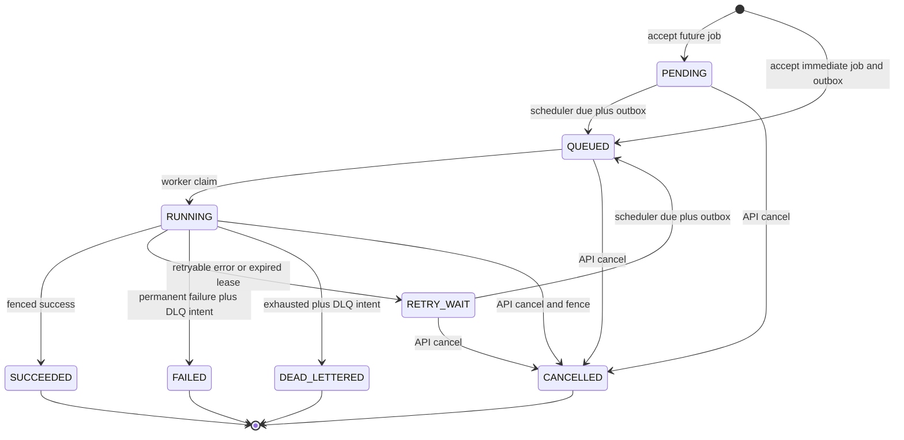

# FluxRail: low-level design

Status: proposed Phase 0 implementation contract. SQL and pseudocode are design examples, not executable project artifacts. [HLD](HLD.md) · [Roadmap](ROADMAP.md) · [README](../README.md)

## Proposed Go layout

```text
cmd/api/                 HTTP server entry point
cmd/worker/              Consumer group and handler execution entry point
cmd/controller/          Outbox, scheduler, and recovery loops
internal/api/            Routes, DTOs, validation, error mapping
internal/jobs/           States, transition rules, retry policy, handler contracts
internal/handlers/       Fixed built-in handlers
internal/worker/         Partition loops, semaphore, leases, shutdown
internal/scheduler/      Due-job selection and promotion
internal/recovery/       Expired attempts and queued reconciliation
internal/kafka/          Envelopes, producer, consumer, lag collection
internal/storage/        pgx queries and transaction boundaries
internal/outbox/         Publication claims, acknowledgement, retry
internal/config/         Validated environment configuration
internal/observability/  slog, Prometheus, future tracing
migrations/             Versioned golang-migrate SQL
deployments/docker/     Compose and application Dockerfiles, later
deployments/helm/       Chart and local demo values, later
tests/integration/      Real PostgreSQL/Kafka behavior
tests/failure/          Kill, restart, outage, rebalance experiments
tests/load/             k6 scripts and workload descriptions
docs/                   Design, ADRs, later runbooks and benchmark reports
```

Use a single Go module, with the repository module path finalized in Phase 1. Keep entry points thin. Storage methods accept contexts and explicit transactions for multi-table operations. Define small interfaces only at boundaries that need substitution in meaningful tests; avoid a generic repository framework. Register handlers once at startup and reject unknown types before acceptance.

## Lifecycle

| State | Meaning | Terminal? |
|---|---|---|
| `PENDING` | Accepted with a future schedule; no ready event yet | No |
| `QUEUED` | Current generation eligible; durable ready outbox intent exists | No |
| `RUNNING` | Attempt owns a database lease and fencing token | No |
| `RETRY_WAIT` | Prior attempt closed; waiting for persisted `next_run_at` | No |
| `SUCCEEDED` | Current fenced attempt committed a result | Yes |
| `FAILED` | Non-retryable handler/system contract failure | Yes |
| `DEAD_LETTERED` | Retryable failure or abandonment exhausted the attempt budget | Yes |
| `CANCELLED` | Cancellation transaction won; future FluxRail state changes fenced | Yes |



The diagram lists all state-changing edges. API owns acceptance and cancellation; scheduler owns due promotion; workers own claims and normal outcomes; recovery owns expired-lease transitions. Recovery can republish a `QUEUED` job without changing state or generation. Dispatcher never changes job status. Every transition updates `updated_at`; terminal transitions set `finished_at` and clear lease fields.

Cancellation locks the job. If nonterminal, set `CANCELLED`, increment `fence_token`, clear its lease, and close any running attempt as `CANCELLED` in the same transaction. Worker renewal observes loss of ownership and cancels the handler context. If completion commits first, cancellation returns `409` with terminal state; if cancellation commits first, completion affects zero rows. This is immediate logical cancellation, not a guarantee that computation or external effects have stopped. Repeating cancellation of `CANCELLED` returns `200`.

Manual retry never reopens a terminal row: it creates a child job with fresh counters, preserving audit history. It is permitted only for `FAILED` or `DEAD_LETTERED`. A new job may repeat business effects; the operator must understand that distinction. Consumption means a transport record was read; success means a fenced database transaction committed `SUCCEEDED`.

## Database schema

Proposed PostgreSQL schema; generate UUIDs in Go. Use UTC timestamps and database time for schedule/lease comparisons. Enumerated text checks keep migrations explicit. SQL shown here must become tested migrations in Phase 1.

```sql
CREATE TABLE jobs (
  id uuid PRIMARY KEY,
  parent_job_id uuid REFERENCES jobs(id),
  job_type text NOT NULL CHECK (job_type IN
    ('simulate_report','transform_json','simulate_compute')),
  payload jsonb NOT NULL CHECK (jsonb_typeof(payload) = 'object'),
  status text NOT NULL CHECK (status IN
    ('PENDING','QUEUED','RUNNING','RETRY_WAIT',
     'SUCCEEDED','FAILED','DEAD_LETTERED','CANCELLED')),
  idempotency_scope text NOT NULL DEFAULT 'submit',
  idempotency_key text,
  request_hash text NOT NULL CHECK (length(request_hash) = 64),
  max_attempts integer NOT NULL CHECK (max_attempts BETWEEN 1 AND 10),
  attempts_started integer NOT NULL DEFAULT 0,
  timeout_seconds integer NOT NULL CHECK (timeout_seconds BETWEEN 1 AND 300),
  dispatch_generation bigint NOT NULL DEFAULT 0 CHECK (dispatch_generation >= 0),
  fence_token bigint NOT NULL DEFAULT 0 CHECK (fence_token >= 0),
  next_run_at timestamptz NOT NULL,
  last_enqueued_at timestamptz,
  lease_owner uuid,
  lease_expires_at timestamptz,
  result jsonb,
  error_code text,
  error_message text,
  created_at timestamptz NOT NULL DEFAULT clock_timestamp(),
  updated_at timestamptz NOT NULL DEFAULT clock_timestamp(),
  finished_at timestamptz,
  UNIQUE (idempotency_scope, idempotency_key),
  CHECK (attempts_started BETWEEN 0 AND max_attempts),
  CHECK ((status = 'RUNNING') =
    (lease_owner IS NOT NULL AND lease_expires_at IS NOT NULL)),
  CHECK ((lease_owner IS NULL) = (lease_expires_at IS NULL)),
  CHECK ((status IN ('SUCCEEDED','FAILED','DEAD_LETTERED','CANCELLED'))
    = (finished_at IS NOT NULL))
);

CREATE TABLE job_attempts (
  job_id uuid NOT NULL REFERENCES jobs(id),
  attempt_no integer NOT NULL CHECK (attempt_no >= 1),
  dispatch_generation bigint NOT NULL,
  fence_token bigint NOT NULL,
  worker_id uuid NOT NULL,
  status text NOT NULL CHECK (status IN
    ('RUNNING','SUCCEEDED','FAILED','ABANDONED','CANCELLED')),
  started_at timestamptz NOT NULL DEFAULT clock_timestamp(),
  finished_at timestamptz,
  error_code text,
  error_message text,
  result jsonb,
  PRIMARY KEY (job_id, attempt_no),
  UNIQUE (job_id, fence_token),
  CHECK ((status = 'RUNNING') = (finished_at IS NULL))
);

CREATE TABLE outbox_events (
  id uuid PRIMARY KEY,
  job_id uuid REFERENCES jobs(id),
  event_kind text NOT NULL CHECK (event_kind IN ('ready','dlq','quarantine')),
  topic text NOT NULL CHECK (topic IN
    ('fluxrail.jobs.ready','fluxrail.jobs.dlq')),
  message_key text NOT NULL,
  envelope jsonb NOT NULL,
  source_key text UNIQUE,
  created_at timestamptz NOT NULL DEFAULT clock_timestamp(),
  available_at timestamptz NOT NULL DEFAULT clock_timestamp(),
  claim_token uuid,
  claim_until timestamptz,
  publish_attempts integer NOT NULL DEFAULT 0 CHECK (publish_attempts >= 0),
  published_at timestamptz,
  last_error text,
  CHECK ((claim_token IS NULL) = (claim_until IS NULL))
);

CREATE INDEX jobs_due_idx ON jobs(next_run_at, id)
  WHERE status IN ('PENDING','RETRY_WAIT');
CREATE INDEX jobs_expired_idx ON jobs(lease_expires_at, id)
  WHERE status = 'RUNNING';
CREATE INDEX jobs_queued_idx ON jobs(last_enqueued_at, id)
  WHERE status = 'QUEUED';
CREATE INDEX jobs_list_idx ON jobs(created_at DESC, id DESC);
CREATE INDEX jobs_status_list_idx ON jobs(status, created_at DESC, id DESC);
CREATE UNIQUE INDEX attempts_one_running_idx ON job_attempts(job_id)
  WHERE status = 'RUNNING';
CREATE INDEX outbox_due_idx ON outbox_events(available_at, id)
  WHERE published_at IS NULL;
CREATE INDEX outbox_job_idx ON outbox_events(job_id);
```

`attempts_started` counts every committed claim, including attempts that crash before calling a handler. It never resets. `max_attempts` includes the first execution. A fencing token is monotonic per job and changes on claims and revocations; it is distinct from dispatch generation, which identifies eligible executions. Worker identity is a process UUID, not a pod name.

`jobs.result` is the current successful result; attempts retain outcome history. Cap serialized payload/result to 64 KiB in application validation before writes; large artifact references are a future extension. Error messages are sanitized and bounded to 2 KiB. Outbox envelopes contain identifiers/metadata rather than full handler payloads. For malformed messages, store a bounded raw prefix, hash, length, and source position in quarantine metadata.

Unique non-null idempotency keys resolve concurrent API requests. Null keys permit independent submissions. No automatic job or key deletion in the MVP; if retention is later introduced, document when idempotency protection expires. Proposed maintenance retains published normal outbox rows seven days and attempts/jobs for the entire demo; cleanup never deletes unpublished events or nonterminal jobs. Retain quarantine source-position deduplication tombstones indefinitely in the MVP, even after payload cleanup, so a later replay cannot create a second quarantine intent. Cleanup must preserve enough terminal DLQ metadata to report publication status after the full envelope is pruned. Backups and retention tooling are later operational work.

Partial indexes serve due scans, expired leases, and queued repairs. Primary-key claims need no status-only index. All multi-row loops lock bounded batches ordered by due time and ID with `FOR UPDATE SKIP LOCKED`. Lock jobs before their attempt rows everywhere to avoid inconsistent lock ordering. Use short transactions, parameterized SQL, bounded retries for deadlocks/serialization failures, and a statement timeout.

## REST API

JSON only, `/api/v1`, UUID path IDs, RFC3339 UTC timestamps. Reject unknown top-level fields, unsupported handlers, malformed JSON/UUID/cursor (`400`), unsupported content type (`415`), and oversized requests (`413`). Semantic payload/range errors use `422`. Missing resources use `404`; unavailable database/schema uses `503`; configured admission rejection uses `429` and `Retry-After`. Include `X-Request-ID` in responses.

| Endpoint | Contract |
|---|---|
| `POST /api/v1/jobs` | `202` after durable acceptance; `200` for a matching idempotent replay; `409` for same key/different request |
| `GET /api/v1/jobs/{id}` | `200` full job, bounded result, ordered attempts, and DLQ publication status; `404` absent |
| `GET /api/v1/jobs` | `200` keyset page; optional `status`, `type`, `limit`, `cursor` |
| `POST /api/v1/jobs/{id}/cancel` | Empty body; `200` when cancellation commits/already cancelled; `409` other terminal state |
| `POST /api/v1/jobs/{id}/retry` | Empty body, required idempotency key; `202` new child, `200` matching replay; `409` ineligible source |
| `GET /healthz` | `200 {"status":"ok"}` if local HTTP/event loop alive; no dependency probe |
| `GET /readyz` | `200 {"status":"ready"}` or `503 {"status":"not_ready"}` based on role dependencies |
| `GET /metrics` | Prometheus text exposition, internal listener only |

Submission example:

```json
{
  "type": "simulate_report",
  "payload": {"rows": 1000},
  "max_attempts": 3,
  "timeout_seconds": 30,
  "run_at": "2026-10-26T10:00:00Z"
}
```

`type`/`payload` required. Defaults: `max_attempts=3`, `timeout_seconds=30`, immediate execution when `run_at` omitted. Supplied `run_at` may be past (immediate) or up to 30 days ahead. Future submissions start `PENDING` with generation zero; immediate submissions start `QUEUED` with generation one. Do not expose retry-backoff tuning per job in the MVP.

Idempotency keys are optional for submission, 1–128 printable ASCII characters when present. Compute SHA-256 over normalized request fields: handler type, canonical JSON payload, effective default attempts/timeout, and supplied UTC `run_at` or an explicit `immediate` marker. Reject duplicate JSON object keys; canonicalize nested objects, preserve array order, and normalize numbers without float64 precision loss. Omitted time must hash as `immediate`, not the server's current time. Store scope `submit` or `retry:<source UUID>` and the hash. Insert under the unique constraint; a racing loser reads the winner after its transaction commits, compares hashes, and returns its existing resource. Replay lookup precedes new-job admission checks. Rollback means no acceptance. Unexpected commit outcome is resolved by retrying the same key.

Manual retry locks the source row, requires `FAILED`/`DEAD_LETTERED`, and copies its type, payload, timeout, and max attempts into an immediate child. Store `parent_job_id`; its request hash includes source UUID and operation. Same retry key returns the same child, different keys deliberately create separate jobs. `SUCCEEDED`, `CANCELLED`, and active sources return `409`; there is no automatic DLQ-consumer replay.

Example terminal query response:

```json
{
  "id": "0b7f5911-b420-4da9-8361-5461a8dd658c",
  "type": "simulate_report",
  "status": "SUCCEEDED",
  "attempts_started": 1,
  "max_attempts": 3,
  "dispatch_generation": 1,
  "created_at": "2026-10-25T12:00:00Z",
  "updated_at": "2026-10-25T12:00:02Z",
  "finished_at": "2026-10-25T12:00:02Z",
  "next_run_at": "2026-10-25T12:00:00Z",
  "result": {"rows_processed": 1000},
  "error": null,
  "dlq_publication": "not_applicable",
  "attempts": [{"attempt_no": 1, "status": "SUCCEEDED"}]
}
```

Attempt objects also include worker ID, start/end time, generation, and bounded error/result. The maximum ten attempts bounds this response. `dlq_publication` is `not_applicable`, `pending`, or `published`, derived from terminal outbox state. Never report DLQ acknowledgement from job status alone.

Error shape:

```json
{"error":{"code":"idempotency_conflict","message":"Key already used for another request","request_id":"req-123"}}
```

List defaults to 50, maximum 100, sorted `(created_at DESC,id DESC)`. Cursor is versioned base64url JSON containing last timestamp/ID, initial database-time upper bound, and normalized filters; validate length, values, and filter match. Fetch `limit+1` rows with tuple comparison below the last key. Response is `{"items":[],"next_cursor":null}` or a continuation cursor. No offset pagination, total-count scan, or promise of a repeatable snapshot under concurrent status changes. Do not expose payload/result in list summaries.

### Handler contract

A handler accepts `(context, job ID, validated payload)` and returns bounded JSON or a typed permanent/retryable error. No shell execution, user-supplied code, arbitrary paths, or network requests. Honor context cancellation in every bounded loop. Panic recovery records `handler_panic` as permanent rather than crashing the worker. A deadline timeout is retryable, within the attempt budget.

| Handler | Input bounds | Controlled behavior |
|---|---|---|
| `simulate_report` | `rows` integer 1–100000 | Iterate deterministic synthetic rows; return processed count/checksum, no file writes |
| `transform_json` | `records` array of at most 1000 objects; total payload ≤64 KiB | Return records with top-level keys sorted in canonical serialization; preserve values and array order |
| `simulate_compute` | `iterations` integer 1–1000000, `seed` unsigned 32-bit integer | Deterministic bounded integer checksum with explicit wrap rules, context checks every 1024 iterations |

Validation must also ensure any output fits 64 KiB. For `simulate_report`, SHA-256 the UTF-8 stream of decimal row indices 0 through rows-1, each followed by LF, and return lowercase hexadecimal checksum with rows_processed. For `simulate_compute`, initialize unsigned 64-bit x from seed and repeat x = x * 6364136223846793005 + 1442695040888963407 modulo 2^64 for the requested iterations; return checksum as a fixed 16-character lowercase hexadecimal string. Freeze golden examples in Phase 3 before implementing handlers. Failure injection belongs in test-only handlers/builds, not public arbitrary-error switches.

## Kafka contract

| Setting | Proposed local default |
|---|---|
| Ready topic | `fluxrail.jobs.ready`, three partitions, replication factor one |
| DLQ topic | `fluxrail.jobs.dlq`, three partitions, replication factor one |
| Consumer group | `fluxrail.workers.v1`, ready topic only |
| Record key | Canonical job UUID; poison records use source-position key |
| Retention | Ready: seven days; DLQ: fourteen days; delete policy, no compaction |
| Broker safety | KRaft single combined broker/controller, persistent volume, min ISR one |
| Producer | Idempotence enabled, all-ISR acknowledgements, bounded retries/delivery timeout |
| Consumer | Auto commit disabled, earliest on missing/out-of-range offset with alert, cooperative assignment |
| Record limits | Application envelope ≤16 KiB; align producer/broker/fetch caps above that |

Retention values are proposed operational settings, not installed configurations. No optional `fluxrail.jobs.events` topic is needed for the MVP. Topic creation is explicit, not auto-create on typo. Partition changes require a documented rollout because key-to-partition mapping changes.

Ready envelope (payload is read from PostgreSQL, never trusted from Kafka):

```json
{
  "schema_version": 1,
  "event_id": "4802efec-3fe2-46d1-bceb-3859c52b77e0",
  "event_type": "job.ready",
  "job_id": "0b7f5911-b420-4da9-8361-5461a8dd658c",
  "dispatch_generation": 1,
  "occurred_at": "2026-10-25T12:00:00Z"
}
```

DLQ envelope:

```json
{
  "schema_version": 1,
  "event_id": "48745556-80bb-4336-830d-509e532333af",
  "event_type": "job.dead_letter",
  "job_id": "0b7f5911-b420-4da9-8361-5461a8dd658c",
  "dispatch_generation": 3,
  "occurred_at": "2026-10-25T12:05:00Z",
  "reason": "attempts_exhausted",
  "attempt_no": 3,
  "error_code": "handler_timeout"
}
```

Additive optional fields are allowed in schema v1; unknown versions/event types and invalid required fields are quarantined rather than guessed. Malformed/oversized records and missing-job references insert a `quarantine` outbox event targeting DLQ, keyed/deduplicated by `source_key=topic:partition:offset`. Include original event ID if parseable, reason, raw SHA-256, bounded 2 KiB prefix, original byte length, source group/topic/partition/offset. No recursive DLQ consumption occurs. Only acknowledge poison records once quarantine intent commits; database outage must stop advancement. Source-offset uniqueness prevents duplicate quarantine on redelivery. Operator correction of a bad event uses database-backed API retry/repair, not blind reposting of untrusted payloads.

## Reliable execution algorithms

All database pseudocode is transactionally scoped where indicated. Use `clock_timestamp()` captured after acquiring each relevant job lock. Database time decides schedule eligibility and lease validity; conservative monotonic local timers enforce handler deadlines and renewal safety margins.

### 1. Accept and enqueue

```text
validate request and canonicalize/hash
if key present: find existing (scope,key); compare hash and return on match
check configured admission thresholds
BEGIN
  insert job, guarding unique (scope,key)
  if future: state=PENDING, generation=0, next_run_at=run_at
  else: state=QUEUED, generation=1, next_run_at=db_now,
        last_enqueued_at=db_now; insert ready outbox with new event UUID
COMMIT
return 202 only after successful commit
on unique conflict: rollback; read committed winner, compare hash
```

The job row and ready intent must never commit separately. Delayed acceptance intentionally has no outbox until due promotion.

### 2. Publish outbox

```text
BEGIN
  select at most OUTBOX_BATCH_SIZE unpublished, available rows
    whose claim is absent or expired
    ORDER BY available_at,id FOR UPDATE SKIP LOCKED
  set per-row random claim_token, claim_until=db_now+30s
  increment publish_attempts
COMMIT
for each claimed row with bounded producer concurrency:
  publish exact persisted envelope/key; wait for acknowledgement (deadline 10s)
  if acknowledged:
    update published_at only if claim_token still matches and unpublished
  else:
    clear claim and set available_at=now+capped exponential backoff
    only if claim_token still matches; save bounded error
```

Ensure batch size/concurrency keeps every delivery deadline within the claim interval or renew claims. Crashed claims expire. An ambiguous acknowledgement retries the same event UUID. A stale publisher cannot overwrite another dispatcher's claim. Kafka producer idempotence does not suppress a new producer session or later application resend. Never discard an unpublished outbox event after a finite retry count; alert on age and repeated permanent configuration errors. Pausing a broken producer is preferable to busy-looping.

### 3. Promote due jobs

```text
BEGIN
  lock batch where status in (PENDING,RETRY_WAIT) and next_run_at <= db_now
    ORDER BY next_run_at,id FOR UPDATE SKIP LOCKED
  for each: status=QUEUED; generation++; last_enqueued_at=db_now
            insert ready outbox in same transaction
COMMIT
```

### 4. Claim, execute, renew

Each worker runs one sequential processing loop per assigned partition; a semaphore caps total active handlers. At most one fetched record per partition enters execution. Pause partitions when no slot is available; bound library prefetch and internal queues. Keep polling/group heartbeats responsive independently from handler duration. A record remains uncommitted while its normal handler executes. During Phase 3, before recovery exists, defer a same-generation RUNNING duplicate without committing it until the original attempt has a durable disposition; do not use the Phase 4 recoverable-lease shortcut.

```text
decode/validate envelope; quarantine invalid input durably
BEGIN
  lock job by UUID
  if absent: insert quarantine intent; COMMIT; acknowledge
  if terminal or message generation < current: COMMIT; acknowledge duplicate
  if generation > current:
      insert quarantine intent for inconsistent ready request; COMMIT; acknowledge
  if state in (PENDING,RETRY_WAIT):
      COMMIT; acknowledge obsolete dispatch; scheduler owns next eligibility
  if RUNNING at same generation: COMMIT; acknowledge duplicate only with recovery enabled
      # current persisted lease and recovery loop own eventual resolution
  require QUEUED, matching generation, attempts_started < max_attempts
  increment attempts_started and fence_token
  set RUNNING, lease_owner=worker UUID, lease_expires_at=db_now+30s
  insert RUNNING attempt with same attempt number/generation/fence
COMMIT
execute handler outside transaction with job timeout and cancellable context
every 10s renew only where RUNNING, owner/fence match, lease not expired
if renewal fails/ownership is uncertain: cancel context; do not perform new effects
```

Use a separate small database pool budget for timely renewals. Renewal predicates include `lease_expires_at > clock_timestamp()`; an expired worker cannot resurrect its lease even if recovery has not yet run. On transient database failures, retry renewal only within a conservative monotonic local deadline derived from the last successful renewal request start; cancel before the database lease could expire. Never assume an unacknowledged renewal succeeded.

### 5. Persist outcome and retry

```text
BEGIN
  lock job; capture current database time after lock
  require RUNNING, matching owner and fence, unexpired lease
  update corresponding RUNNING attempt (require exactly one row)
  on success: job SUCCEEDED, bounded result, finished_at
  on permanent error: job FAILED, finished_at, insert DLQ outbox
  on retryable error and attempts_started < max_attempts:
    job RETRY_WAIT, next_run_at=db_now+persisted random delay
  on retryable error and no budget:
    job DEAD_LETTERED, finished_at, insert DLQ outbox
  clear lease; update error fields and updated_at
COMMIT
only after durable disposition, mark partition record completed
```

Attempt failure status is `FAILED`, while the job may be `RETRY_WAIT` or terminal. Backoff after attempt `n` uses full jitter: `uniform(0,min(300s,1s*2^(n-1)))`. Saturate the exponential at the cap before multiplying to avoid integer overflow. Sample once and persist `next_run_at` in the outcome transaction; retries of that transaction may resample before commit, but a committed delay never changes due to redelivery. Timeout and abandoned attempt are retryable. Classification is typed, not based on parsing error strings. Reject oversized handler output as permanent `result_too_large`.

If outcome commit acknowledgement is lost, read current job/attempt by fence before retrying. If a terminal outcome or later generation already exists, do not rerun the handler. If the database remains unavailable or ownership expired, stop effects and leave resolution to recovery.

### 6. Recover abandoned jobs

```text
BEGIN
  select expired RUNNING jobs FOR UPDATE SKIP LOCKED, bounded batch
  recheck expiry using database time after locking
  increment fence_token; close RUNNING attempt as ABANDONED
  if attempts remain: RETRY_WAIT with persisted jittered next_run_at
  else: DEAD_LETTERED plus DLQ outbox
  clear lease and update timestamps
COMMIT
```

Recovery and renewal serialize on the job row. If renewal wins before expiry, recovery skips it on recheck. If expiry/cancellation wins, stale completion fails. A process heartbeat alone never grants execution ownership; per-attempt leases are authoritative.

Queued reconciliation scans `QUEUED` jobs whose `last_enqueued_at` is older than 15 minutes. Under the job lock, recheck state and age; if no unpublished ready outbox exists for that job, insert a new ready event **with the same generation** and update `last_enqueued_at`. Limit repair to 100 jobs per minute per controller; the default is one controller. Multiple replicas preserve per-job cooldown through the locked timestamp check, but their aggregate repair rate can reach the per-controller limit multiplied by replica count. Alert on repeated repair and tune that aggregate rate deliberately. The same generation permits any retained old record to claim the job and avoids starvation from constantly invalidating backlogged messages. Published-event cleanup and queue repair must never delete authoritative jobs.

### 7. Commit offsets and handle rebalances

```text
per assigned partition, in record order:
  receive record only when bounded capacity is available
  process until durable disposition, or cancel on partition revocation
  after durable disposition, synchronously commit record.offset+1
  if commit fails or partition is lost: allow redelivery; do not infer rollback
  never commit a fetched later record past an unresolved earlier record
```

Durable disposition means outcome/retry committed, cancellation/terminal/obsolete duplicate observed, valid running duplicate observed, or quarantine intent committed. No commit on an uncertain database transaction. Commit APIs often accept a record and compute the next offset internally; validate the selected franz-go API rather than adding one twice.

Use explicit assignment/revocation/lost callbacks. Stop dispatch for revoked partitions, cancel handlers, wait a bounded drain period, and commit only completed owned offsets before returning from revoke. On lost ownership, do not commit; cancel and leave the persisted lease for recovery. Do not hold a rebalance-blocking poll for a 300-second handler. Initial implementation should use partition runners with bounded callbacks and verify its behavior against the pinned client's documentation and tests.

### 8. Graceful shutdown

Mark readiness false; stop fetching new work and pause assignments. Keep lease renewal running during a drain of up to 20 seconds. Persist finished outcomes and commit completed owned offsets. At the deadline cancel remaining handler contexts, stop renewals, close the consumer and HTTP listener, and exit within 30 seconds. Remaining attempts recover by lease expiry; never mark success merely because shutdown began. Kubernetes termination grace starts at 40 seconds, leaving margin beyond application shutdown. Handler timeout can exceed the drain budget; such work may retry after scale-down.

## Failure analysis

| Failure point | Durable state | Required recovery / limitation |
|---|---|---|
| After job commit, before publish | Job and outbox | Dispatcher resumes unpublished row |
| After publish, before recording acknowledgement | Possibly delivered; outbox pending | Republish same event; state/generation claim suppresses duplicate |
| After consume, before claim | No attempt, offset uncommitted | Redelivery or queued reconciliation |
| After claim, before/during handler | RUNNING lease and attempt | Lease expiry closes abandonment, retries within budget |
| After success, before offset commit | SUCCEEDED | Redelivery sees terminal state and commits without execution |
| Lease expires while old worker runs | Token invalid after expiry/recovery | Renew/completion denied; external effects need target idempotency/fencing |
| Broker unavailable | Committed API jobs, growing outbox | Producer backs off; admission limits; resume publication after recovery |
| Database unavailable | Existing Kafka data, uncertain ownership | No new claims/commits; cancel when lease safety lost; recover later |
| Duplicate consumer delivery | Current/terminal job row | Atomic claim, attempt constraint, generation check |
| Cancel races completion | Serialized job lock | First committed transition wins; cancellation cannot undo side effects |
| Offset aged out / topic data removed | QUEUED authoritative jobs | Earliest available reset with alert; rate-limited same-generation republish |
| Crash during quarantine | Uncommitted or committed outbox intent | Redelivery; unique source position prevents duplicate quarantine intent |
| Permanent disk/database volume loss | Authoritative state may be gone | Outside local recovery guarantee; requires backups/restore |

## Configuration and deployment contract

Proposed environment names; Phase 1 implements and documents parsing. Invalid/unsafe combinations fail startup. Defaults are development proposals, not measured tuning.

| Variable | Default / rule |
|---|---|
| `FLUXRAIL_DATABASE_URL` | Required secret, never logged |
| `FLUXRAIL_KAFKA_BROKERS` | Required comma-separated reachable advertised addresses |
| `FLUXRAIL_HTTP_ADDR` | `127.0.0.1:8080` on host; explicit `:8080` in containers |
| `FLUXRAIL_ADMIN_ADDR` | `127.0.0.1:9090`; internal probes/metrics |
| `FLUXRAIL_LOG_LEVEL` | `info`; JSON slog output |
| `FLUXRAIL_DB_MAX_CONNS` | 10 per process, budget across replicas |
| `FLUXRAIL_WORKER_CONCURRENCY` | 3; actual work bounded by assigned partitions |
| `FLUXRAIL_CONSUMER_GROUP` | `fluxrail.workers.v1` |
| `FLUXRAIL_READY_TOPIC` / `FLUXRAIL_DLQ_TOPIC` | Names fixed above; validate configuration against allowlist |
| `FLUXRAIL_LEASE_TTL` / `FLUXRAIL_RENEW_INTERVAL` | `30s` / `10s`; TTL at least three intervals |
| `FLUXRAIL_SCHEDULER_INTERVAL` / `FLUXRAIL_RECOVERY_INTERVAL` | `1s` / `5s` |
| `FLUXRAIL_OUTBOX_BATCH_SIZE` / `FLUXRAIL_OUTBOX_POLL_INTERVAL` | 20 / `500ms`; delivery concurrency/claim renewal must fit claim TTL |
| `FLUXRAIL_MAX_ACTIVE_JOBS` / `FLUXRAIL_MAX_PENDING_OUTBOX` | 100000 / 100000, approximate admission thresholds |
| `FLUXRAIL_SHUTDOWN_TIMEOUT` | `30s`, 20-second handler drain |

Expose healthz, readyz and metrics on the administrative listener for each role. Override the host admin address for every additional local process to avoid port collisions. API health/readiness aliases may be added to the public listener only if documented; future validation below targets the admin port.

HTTP server: 5-second header timeout, 10-second read/write timeout for bounded API calls, 60-second idle timeout, 256 KiB body limit. Database statement timeout starts at 5 seconds; renewal statements need tighter deadlines than the remaining lease window. Kafka producer delivery deadline starts at 10 seconds. Controller polling uses jitter and backs off on dependency failure.

API readiness needs PostgreSQL and compatible migrations, not Kafka; broker outages can still permit durable acceptance within admission limits. Worker readiness needs PostgreSQL, broker metadata, registry validation, and a live consumer loop; zero assignments alone is not failure. Controller readiness needs database and broker publication capability. Dependency failures affect readiness, not liveness. Migrations run as an explicit one-shot step before workloads, never independently from every replica.

Compose Phase 1 supplies persistent volumes, explicit KRaft settings, topic initialization, host/internal listeners, development credentials, and dependency health checks. Application images arrive in Phase 6, run as nonroot, and support Linux ARM64/AMD64. kind topology and hybrid caveats are specified in the HLD. Helm needs startup/readiness/liveness probes, Secrets references, resource requests/limits, configurable replicas and infrastructure persistence, and optional KEDA resources.

Initial container budgets for experiments: API 100m CPU/128 MiB request and 500m/256 MiB limit; worker 250m/256 MiB and 1 CPU/512 MiB; controller 100m/128 MiB and 500m/256 MiB. Kafka begins with a bounded 512 MiB JVM heap and roughly 1.5 GiB memory limit; PostgreSQL roughly 512 MiB. These allocations require measurements and can be adjusted; do not imply they are proven sufficient. Monitoring adds additional memory. Load tests must record OOMs/throttling rather than hiding failed runs.

## Observability

| Metric | Type and semantics | Bounded labels |
|---|---|---|
| `fluxrail_jobs_submitted_total` | Counter, new durable acceptance, excluding idempotent replay | `job_type` |
| `fluxrail_jobs_completed_total` | Counter, committed success | `job_type` |
| `fluxrail_jobs_failed_total` | Counter, terminal FAILED/DEAD_LETTERED | `job_type`, `reason` allowlist |
| `fluxrail_jobs_retried_total` | Counter, transition to RETRY_WAIT | `job_type`, `reason` |
| `fluxrail_job_duration_seconds` | Histogram, per-attempt elapsed duration | `job_type`, `outcome` |
| `fluxrail_jobs_in_progress` | Gauge, authoritative RUNNING database count | none |
| `fluxrail_worker_active_jobs` | Gauge, local executing handlers | none; scrape target identifies process |
| `fluxrail_outbox_pending_events` | Gauge, unpublished database rows | `event_kind` |
| `fluxrail_outbox_oldest_age_seconds` | Gauge, oldest unpublished event age | none |
| `fluxrail_duplicate_records_total` | Counter, duplicate/stale record dispositions | `reason` allowlist |
| `fluxrail_lease_recoveries_total` | Counter, expired attempt transitions | `job_type` |
| `fluxrail_kafka_consumer_lag` | Gauge, end offset minus committed offset | `topic`, `partition`, `group` allowlist |

Do not label with job/event/worker UUID, arbitrary error text, payload fields, or unbounded handler names. Proposed duration buckets: 0.01, 0.05, 0.1, 0.5, 1, 5, 15, 30, 60, 300 seconds. Add HTTP request latency/status-class metrics with normalized route names. Process-local counters increment after commits and may undercount on crash between commit and observation; they are operational signals, not an audit ledger. Database queries provide authoritative counts/history.

One designated lag collector uses franz-go admin APIs to read group committed offsets and topic end offsets, exporting lag with a collection-success signal; missing/invalid offsets are unknown, not zero. It can run in the single controller initially; multiple controllers need a separate single collector to avoid double-counted gauges. Do not infer group lag from client fetch-buffer metrics. Kubernetes KEDA reads broker/group offsets itself; it does not depend on this Prometheus metric.

Dashboard panels: acceptance/completion rates, terminal errors by bounded reason, duration p50/p95, RUNNING versus active handlers, queued/retry-wait counts, oldest queued age, oldest outbox age, per-partition lag, renew/recovery rate, HTTP errors, database pool wait, CPU/RSS, and restarts. Query authoritative database gauges from a single collector and show scrape/collection failure explicitly.

Initial alerts to tune: oldest unpublished event >60 seconds for five minutes; sustained lag growth for ten minutes; expired leases repeatedly recovered; database/broker readiness failure; no completed jobs while eligible backlog persists; repeated poison records; metrics collection failure. Scheduled future jobs must not trigger a stuck-work alert. Alert thresholds are starting policies, not SLOs.

Logs carry request ID, job ID, event ID, attempt number, fence, generation, topic/partition/offset, and bounded reason where relevant. Trace propagation is later: accept W3C HTTP context, copy trace context into Kafka headers, link each retry attempt to its scheduling event, and emit database/producer/handler spans without payloads. Never imply tracing is already implemented.
